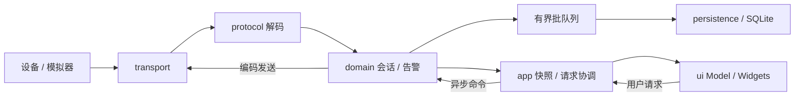

# 03. 概要设计 / 架构设计 HLD

> D1 · 2026-09-23 · 设计态，以下工程模块尚未创建。对应 REQ-ARCH-001、REQ-THREAD-001、REQ-RECOVERY-001。

## 1. 分层与数据流



这是运行数据流。编译依赖为 ui → app → domain；transport/protocol/persistence 使用领域值类型/接口，由 app 组合。domain 可依赖 Qt Core，不依赖 QWidget、QTcpSocket、QSqlDatabase；protocol 不依赖 UI/SQL。common 仅放公共值类型、错误与日志基础设施。

| 层 | 负责 | 不负责 |
|---|---|---|
| ui | 展示、输入、GUI Model 与曲线 | 解码、SQL、重连定时 |
| app | 配置、启动/退出、跨线程请求与快照 | 报文字节处理 |
| domain | 会话状态、心跳、命令、告警规则 | 具体网络/SQL/UI |
| transport | 异步 open/close/write、接收 | 自动重连、业务成功判定 |
| protocol | 帧边界、CRC、载荷编解码 | socket、落盘 |
| persistence | schema、事务、查询、写入结果 | UI、通信恢复 |

重连只由 DeviceSession 调度，Transport 不再次自主重试。

## 2. 线程模型

10 个低速设备共享一个 IO 事件循环，每设备独立 Session；不要求每 socket 一线程。S5 引入独立 DB 线程。

| 线程 | 对象与所有权 |
|---|---|
| GUI | MainWindow、DeviceListModel、图表、应用控制器；QThread 管理对象也归 GUI |
| IO | DeviceManager、DeviceSession、Transport、socket/serial/timer、FrameDecoder、AlarmEngine |
| DB | DatabaseWorker、Repository、命名 QSqlDatabase 及所有 QSqlQuery |

无 parent 的 worker 先 moveToThread，在启动槽创建其 socket/定时器/子对象。跨线程使用 queued signal/slot 和值对象，注册自定义元类型；不跨线程传可变对象指针供直接调用。IO 接收和领域处理在同线程，无需为了分层再增加线程。

## 3. 背压与隔离

排队信号不能替代有界队列。遥测采用显式有界缓冲与合并唤醒，禁止逐样本无限排队。

- 解码、发送、DB、曲线都有上限，见 LLD/配置。
- UI 合并显示不改变告警/落盘的完整采样语义。
- DB 失败保留有界待写批次，溢出显式计数；未提交不能报成功。
- Session 状态、解析缓存、计时独立，一台设备异常不清空其他设备数据。
- 日志滚动，同类高频错误聚合计数，避免错误洪泛堵塞 IO。

## 4. 状态与退出

统一枚举：Disconnected / Connecting / Online / Degraded / Reconnecting / Fault；含义和转换以 [LLD](04_DETAILED_DESIGN.md) 为准。Offline 只能是“离线”的显示词，不是新增枚举。

退出顺序：禁止新命令/重试 → IO 停采集并提交末批 → DB 排空或报告未提交数 → worker 在所属线程关闭资源 → quit/finished → 回收。不能先停事件循环再等待 queued 清理；不能强杀或析构运行中的 QThread。

## 5. 规划工程结构

```text
CMakeLists.txt
cmake/
src/{app,domain,transport,protocol,persistence,ui,common}/
simulator/
tests/{unit,integration}/
config/
scripts/
docs/
templates/
```

当前只交付文档和模板。未来使用 target-based CMake、C++17 和 Qt6 Core/Widgets/Network/SerialPort/Sql/Test；客户端/模拟器独立入口，测试链接被测模块。图表后端在 S4 按本地 Qt 可用性选定并记录；更换后端不免除实时曲线验收。

## 6. 技术依据

线程亲和性与事件循环见 [Qt Threads and QObjects](https://doc.qt.io/qt-6/threads-qobject.html)，worker 回收见 [QThread](https://doc.qt.io/qt-6/qthread.html)，SQL 连接线程限制见 [QSqlDatabase](https://doc.qt.io/qt-6/qsqldatabase.html)。线程数量、队列上限和状态策略是本项目设计，非 Qt 的强制配置。
